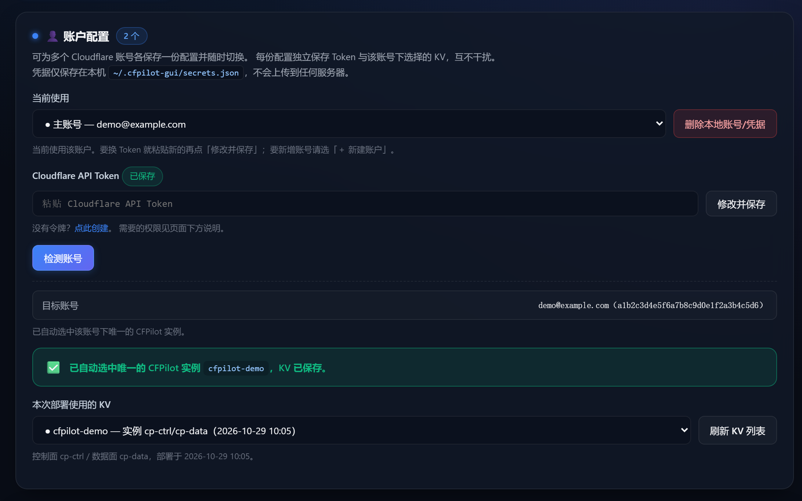
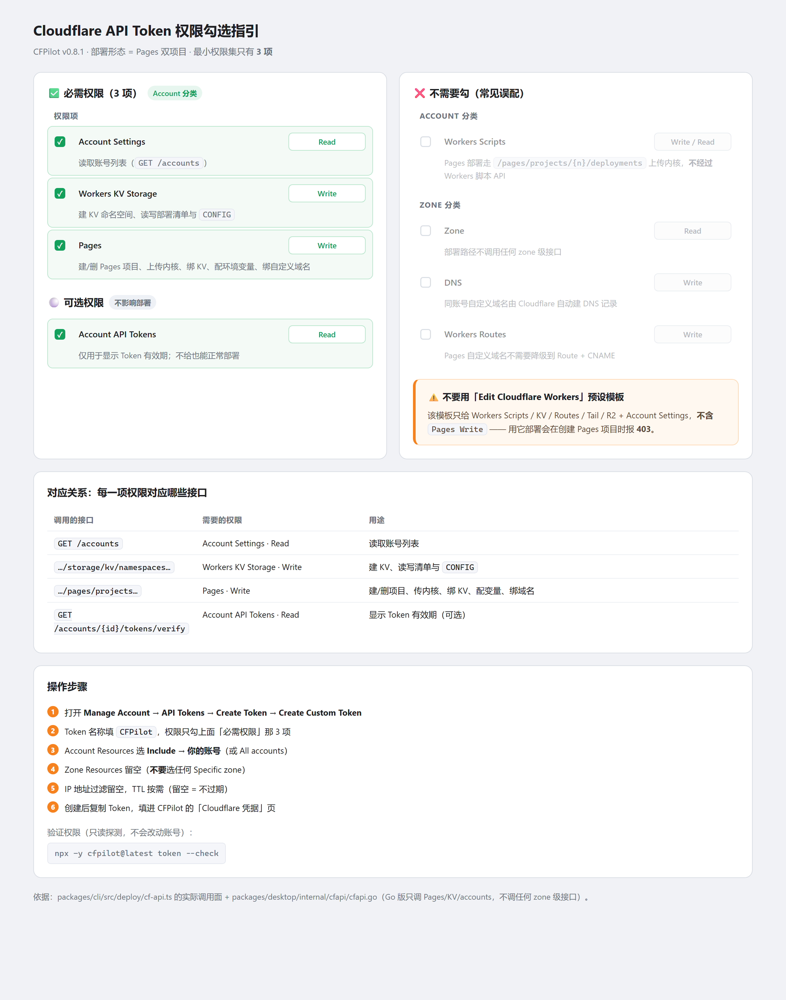

# CFPilot

> Cloudflare 代理微内核 · 真连接优选面板 · 一键部署
> AGPL-3.0 License · 控制面+数据面完全自研（无第三方内核依赖）

· 把「代理内核 + 优选订阅 + 本地真连接优选 + 中文部署向导」整合成一套方案；

· 采用双项目拆分部署：控制面（web 管理面板）跑 Pages，数据面（流量转发）可选 **Pages（默认）** 或 **Workers**；

· 静态脱敏 + 交叉混淆，稳定无1101、8000119，但也支持在触发限制后无损更新部署；

· 解决优选 IP 困扰：**本地真连接优选完全杜绝延迟是** **`-1`**。

***

## 目录

- [部署](#部署)

- [优选 IP](#优选-ip)

- [导入订阅](#导入订阅)

- [使用须知](#使用须知)

- [常见问题](#常见问题)

- [技术实现](#技术实现)

- [配置项与环境变量](#配置项与环境变量)

- [免责声明](#免责声明)

***

## 部署

> ⚠️ **部署前必读**

> 全自动化：填 Token  → 自动部署  → 自动优选换 IP → 自动更新内核 → 日常维护 。
>
> 1. 全自动化使用需获取 Cloudflare Api Token 至少**三个权限**（数据面选 Workers 时是**六个**，见下文权限表）。
> 2. **控制面 + 数据面必须分开**（控制面固定 Pages；数据面可选 Pages 或 Workers）。
>    选 Workers 时**必须**配一个自有域名，`*.workers.dev` 直连不可访问。
> 3. **不要与其它项目共用 KV** 。
> 4. 免 Api Token 部署请**选择手动部署**流程。

<details>
<summary><b>① 远程部署（npx，无需安装）</b></summary>

<br>

```bash
npx -y cfpilot@latest deploy
```

交互式引导会依次完成：检测账号 → 创建/复用 KV → 部署数据面 → 部署控制面 →
绑定变量 → 打印面板地址与密码。

**注意事项**

- 全程约 1-3 分钟，取决于 Cloudflare API 响应

- 部署完成后**立即保存面板密码** —— 云端环境变量是加密的，之后无法再读

- 手动部署没设 `PANEL_PASSWORD` 时，内核会随机生成一个密码并写入 KV 的
  `ADMIN_PW_PLAIN` 供你取回；它只保留到**第一次登录成功**为止（之后自动删除）

- 同一账号部署第二个实例：加 `--new-kv`(不建议同账号多实例)

</details>

<details>
<summary><b>② CLI 安装部署（npm 全局安装）</b></summary>

<br>

```bash
npm i -g cfpilot
cfpilot
```

进入中文交互菜单：

```
┌──────────────────────────────────────────────────┐
│ cfpilot                                          │
├──────────────────────────────────────────────────┤
│ Cloudflare Pages 代理部署与优选                  │
└──────────────────────────────────────────────────┘

  当前状态
  账号  未配置
  实例  未配置
  凭据  未配置

  ❯ 部署新实例
    更新现有实例
    查看实例状态
    本地优选（真连接测速）
    修改面板密码
    检查 Token 权限
    配置（Token / 账号 / KV）
    帮助
    退出
```

也支持子命令（供脚本自动化）：

```bash
cfpilot deploy      # 部署
cfpilot scan        # 本地优选
cfpilot status      # 查看实例
cfpilot token --check  # 检查 Token 权限
cfpilot config      # 配置管理
```

**注意事项**

- 首次进入「配置」菜单填 Token，会自动识别账号与已有实例

- 配置保存在 `~/.cfpilot/config.json`，Token 显示时脱敏

- 该文件权限为 `0600`、目录 `0700`（一旦选择保存 Token，它等同于账号凭据）

- `cfpilot deploy --token <TOKEN>` 会把 Token 留在 Shell 历史里；
  更安全的方式是进入交互菜单填写，或设环境变量 `CF_API_TOKEN`

- 需要 Node.js 18+

</details>

<details>
<summary><b>③ WebUI 部署工具（Go 版图形界面，推荐）</b></summary>

<br>

到 [Releases](https://github.com/xmwengxing/CFPilot/releases) 下载对应平台文件：

| 平台          | 文件                               |
| ----------- | -------------------------------- |
| Windows x64 | `cfpilot-<版本>-windows-amd64.exe` |
| Linux x64   | `cfpilot-<版本>-linux-amd64`       |
| Linux arm64 | `cfpilot-<版本>-linux-arm64`       |

运行后托盘出现图标，系统浏览器自动打开管理界面。
Linux 下载后要先 `chmod +x`，操作流程见下面的 [Linux 版](#linux-版)。




界面分五个页签（**凭据 / 部署 / 优选 / 说明 / 日志**），下方是常驻运行日志（可折叠）。

- **凭据页**：填 Token → 自动检测账号 → 自动列出 KV；账号下只有 **1 个** CFPilot 实例时
  自动选中并保存（如上图），**0 个 / 多个**会用醒目红框提示（选错 KV 会让后续操作作用到别的实例上）

- **部署页**：全新部署会自动新建一个独立 KV（一 KV 一实例，不复用凭据页选中的那个）

- **优选页**：「自动识别」一次填好域名与 WS 路径 → 开始优选 → 回填面板

- **说明页**：安全说明、Token 权限清单、应用更新

**注意事项**

- 单文件静态可执行，**零依赖**，不需要预装 Node.js

- 启动后**自动打开**管理界面（`--no-browser` 可关）

- 服务只监听 `127.0.0.1`，凭据存在本机 `~/.cfpilot-gui/secrets.json`
  （文件 `0600`、目录 `0700`；Windows 下由用户目录的 ACL 保护）

- 「允许局域网访问」默认关闭。开启后仅额外放行私有网段，
  且仍需一次性启动令牌 → Session Cookie 才能操作，不是只靠 Origin 校验

- 应用内更新会先取官方 Release 的 `cfpilot-desktop-SHA256SUMS`，
  校验安装包摘要后再提示替换；清单缺失或摘要不符一律拒绝（镜像不参与校验）

- 右键托盘可查看服务状态、复制地址、修改端口、启停服务、快捷一键优选 IP

- 常用参数：`--no-browser`（不自动开浏览器）、`--no-tray`（无桌面环境）、
  `--console`（日志同时打终端）、`--check`（只自检）

### Linux 版

Linux 版**不是另一套代码**：与 Windows 共用同一份 Go 源码和同一份界面（界面构建后 `go:embed` 进二进制），
仅三处按平台分支——打开浏览器（`xdg-open`）、桌面通知（`notify-send`，未安装时只写日志）、
托盘（D-Bus StatusNotifierItem，纯 Go 实现）。因此**不需要 GTK / libappindicator，也不需要 Node.js**，
`CGO_ENABLED=0` 静态编译，x64 与 arm64 各一份单文件产物。

放置路径随意（程序不依赖当前工作目录，内嵌内核也不会去读旁边目录），但**必须加执行位、建议从终端启动**：

```bash
# 1. 放到固定位置（示例：家目录下的 Applications）
mkdir -p ~/Applications
mv ~/Downloads/cfpilot-<版本>-linux-amd64 ~/Applications/cfpilot

# 2. 浏览器下载的文件默认没有执行位
chmod +x ~/Applications/cfpilot

# 3. 从终端启动（首次运行别双击，见下方说明）
~/Applications/cfpilot
```

启动后托盘出现图标，浏览器自动打开 `http://127.0.0.1:19726/?t=<一次性令牌>`。
`t` 只在本次启动有效，重启会换新的；退出用托盘菜单「退出 CFPilot」。

> 许多文件管理器会双击二进制时把它当文本打开、或直接拒绝执行（取决于桌面设置），
> 所以首次运行请用终端；启动日志也会直接打在终端里，便于确认端口与地址。

**托盘需要一个 StatusNotifierItem 宿主**：KDE / XFCE / Cinnamon / MATE 原生支持；
GNOME 默认不支持（Ubuntu 自带的 AppIndicator 扩展默认启用，所以 Ubuntu 一般可见）。
如果启动后**没有图标**，说明当前桌面没有宿主，改用前台模式即可——服务与界面完全一致，只是没有托盘菜单：

```bash
~/Applications/cfpilot --no-tray                            # 前台跑服务，Ctrl+C 退出
~/Applications/cfpilot --no-tray --no-browser --console      # SSH / 纯命令行：不弹浏览器，日志同时打终端
~/Applications/cfpilot --check                              # 只自检：配置目录 / 端口占用 / 版本
```

| 项目    | Linux 下的位置与行为                                                          |
| ----- | ---------------------------------------------------------------------- |
| 配置与凭据 | `~/.cfpilot-gui/`（`secrets.json` 权限 `0600`、目录 `0700`），格式与 Windows 完全相同 |
| 日志    | `~/.cfpilot-gui/cfpilot.log`（自动滚动）；加 `--console` 时同步打终端                |
| 应用内更新 | 只**下载**到 `~/.cfpilot-gui/updates/`；替换需手动：退出程序 → `chmod +x` 新文件 → 覆盖旧文件 |
| 卸载    | 删除二进制 + `~/.cfpilot-gui/` 目录即可，不写注册表 / 系统目录                            |

### 托盘菜单

| 菜单项        | 作用                         |
| ---------- | -------------------------- |
| 打开业务界面     | 打开管理界面                     |
| 复制服务地址     | 复制当前地址                     |
| 停止服务       | 启停本地服务                     |
| 切换端口       | 预设端口，一键切换                  |
| 允许局域网访问    | 同网段其它设备可访问                 |
| **检查应用更新** | 检查 exe 有无新版（外壳 / 界面 / 优选器） |
| **检查部署更新** | 检查线上内核有无新版（数据面 / 控制面）      |
| 一键优选 IP    | 后台自动完成优选 IP 并回填面板，更新订阅食用   |
| 退出 CFPilot | 停止服务并退出                    |

</details>

<details>
<summary><b>④ 手动部署（Cloudflare 控制台）</b></summary>

<br>备用方案，用仓库根目录的两份压缩包手动上传。

| 文件                                               | 用途                         |
| ------------------------------------------------ | -------------------------- |
| [`CFPilot-dataplane.zip`](CFPilot-dataplane.zip) | 数据面（纯转发，Pages 方式上传）        |
| [`CFPilot-control.zip`](CFPilot-control.zip)     | 控制面（面板与订阅，Pages 方式上传）      |
| [`_worker.js`](_worker.js)                       | 数据面**代码文件**（Workers 方式粘贴用） |

> 三份文件随每次构建自动更新，与本仓库代码一致。

**第 1 步：创建 KV**

Cloudflare 控制台 → **存储和数据库 → KV** → 创建命名空间，记下**命名空间 ID**。

**第 2 步：部署数据面（两种形态二选一）**

控制面**始终**是 Pages 项目；数据面可以选 Pages 或 Workers。
两种形态都可以，区别只有一条：**Workers 必须配自定义域名**。

<details>
<summary><b>2A. Pages 方式（默认，不需要自有域名）</b></summary>

1. **Workers 和 Pages → 创建 → Pages → 上传资产**

2. 项目名随意（建议普通名称，如 `blog-assets-sync`）

3. 上传 `CFPilot-dataplane.zip`，记下项目域名（形如 `xxx.pages.dev`）

4. **设置 → 变量和密钥**，添加：

   | 名称              | 值                  |
   | --------------- | ------------------ |
   | `UUID`          | 自己的 UUID（36 位标准格式） |
   | `WS_PATH`       | 自定义路径，如 `/abc123`  |
   | `ENABLE_TROJAN` | `true` / `false`   |
   | `ENABLE_XHTTP`  | `true` / `false`   |

5. **设置 → 函数 → KV 命名空间绑定**：变量名 `KV` → 第 1 步的命名空间

6. **重新上传一次压缩包**（绑定与变量只对之后的部署生效）

</details>

<details>
<summary><b>2B. Workers 方式（需要自有域名，动态与边缘控制更强）</b></summary>

> ⚠️ `*.workers.dev` 域名直连无法访问，**必须**在最后一步绑一个自定义域名，
> 否则客户端节点全部连不上。该域名要托管在**本 Cloudflare 账号**里
> （Workers 自定义域名不支持外部 CNAME）。

1. **Workers 和 Pages → 创建 → Workers → 从 Hello World 开始**

2. 脚本名随意（建议普通名称），点「部署」

3. 进入 **编辑代码**，删掉默认示例，把仓库根目录 [`_worker.js`](_worker.js)
   的**全部内容**粘贴进去 → 右上角「部署」

   > 代码是单文件 ES module，不需要 `wrangler.toml`，也不需要构建步骤。

4. **设置 → 变量和密钥 → 添加**（与 2A 的表完全一致）：

   | 名称              | 值                  |
   | --------------- | ------------------ |
   | `UUID`          | 自己的 UUID（36 位标准格式） |
   | `WS_PATH`       | 自定义路径，如 `/abc123`  |
   | `ENABLE_TROJAN` | `true` / `false`   |
   | `ENABLE_XHTTP`  | `true` / `false`   |

5. **设置 → 绑定 → 添加 → KV 命名空间**：变量名 `KV` → 第 1 步的命名空间

   > 变量与绑定保存后会自动创建一个新版本并部署；若页面上没有自动生效，
   > 回「部署」页点一次部署即可。

6. **设置 → 域和路由 → 添加 → 自定义域名**：填 `w1.example.com` 这类子域，
   等状态变成 **Active**（证书签发通常 1\~3 分钟）

7. 记下这个**自定义域名** —— 第 3 步的 `DATA_HOST` 用它（不是 `*.workers.dev`）

> 想换回 Pages 形态？删掉这个 Worker，按 2A 重做一遍即可 ——
> 用 CLI / 桌面版更新部署时会**自动**完成这套清理与域名迁移。

</details>

**第 3 步：部署控制面**

1. 另建一个 Pages 项目，上传 `CFPilot-control.zip`

2. **设置 → 变量和密钥**：

   | 名称               | 值                                                         |
   | ---------------- | --------------------------------------------------------- |
   | `UUID`           | 与数据面相同                                                    |
   | `WS_PATH`        | 与数据面相同                                                    |
   | `DATA_HOST`      | 第 2 步记下的**数据面域名**（Pages 的 `*.pages.dev` 或 Workers 的自定义域名） |
   | `PANEL_PATH`     | 面板路径，如 `/mypanel`                                         |
   | `ADMIN_PASSWORD` | 面板登录密码                                                    |

3. **设置 → 函数 → KV 命名空间绑定**：`KV` → 同一个命名空间

4. **重新上传一次压缩包**

**第 4 步：访问**

打开 `https://<控制面域名><PANEL_PATH>`，用 `ADMIN_PASSWORD` 登录。
订阅地址：`https://<控制面域名>/sub/<UUID>`

**更新时**：

- 数据面是 Pages：打开项目 → 新建部署 → 上传新版 `CFPilot-dataplane.zip`

- 数据面是 Workers：打开脚本 → 编辑代码 → 用新版 `_worker.js` 覆盖 → 部署

- 控制面：打开项目 → 新建部署 → 上传新版 `CFPilot-control.zip`

</details>

***

## 优选 IP

部署完成后，建议跑一次本地真连接优选，把「看起来快但实际不可用」的 IP 剔掉。

```bash
# 已安装 CLI
cfpilot scan

# 或直接用 npx
npx -y cfpilot@latest scan
```

交互式引导会：识别实例 → 自动填域名与 WS 路径 → 扫描 → 询问是否回填面板。

**通用流程**

1. **关掉所有代理工具**（含 TUN 模式与系统代理）
2. 选择实例（或手动填数据面域名 + WS 路径）
3. 设置采样数与是否跳过测速后开始优选（建议默认）
4. 扫描完成后选 `y` 自动回填，或选 `N` 复制结果手动粘贴
5. 回填后面板「节点来源 → 手动优选 IP」即可看到列表

- 桌面版根据图形界面提示说明操作，易用性更强。

***

## 导入订阅

面板首页给出三种订阅地址，**按 User-Agent 自动识别格式**：

| 客户端                             | 拿到的格式       |
| ------------------------------- | ----------- |
| Clash Verge / Clash / mihomo    | YAML        |
| sing-box                        | JSON        |
| v2rayN / Shadowrocket / NekoBox | Base64 分享链接 |

也可显式指定：`?target=clash` / `?target=singbox` / `?target=base64`。

节点的关键约定：`server` = 优选出的 **IP**，`sni` / `Host` = **你的域名**（固定），端口 = `443`。

***

## 使用须知

### API Token 权限

在 [Cloudflare 控制台 → API Tokens](https://dash.cloudflare.com/profile/api-tokens)
创建**自定义 Token**，按下面三项勾选（分类都是 **Account**，权限级别都是 **Read/**Edit）：

| 权限项（控制台显示名）                  | 级别   | 用途                                   |
| ---------------------------- | ---- | ------------------------------------ |
| **Account Settings Read**    | Read | 读取账号列表（`GET /accounts`）              |
| **Workers KV Storage Write** | Edit | 建 KV、读写部署清单与 `CONFIG`                |
| **Pages Write**              | Edit | 建/删 Pages 项目、上传内核、绑 KV、配环境变量、绑自定义域名  |
| **Account API Tokens**       | Read | 可选，仅用于显示 Token 有效期                   |
| **Account Analytics Read**   | Read | 可选，仅用于「用量/额度」面板（查 Workers 与 KV 的已用量） |

**数据面用 Workers 模式时，再加一项**：

| 权限项（控制台显示名）         | 级别   | 分类      | 用途                   |
| ------------------- | ---- | ------- | -------------------- |
| **Workers Scripts** | Edit | Account | 上传 / 更新数据面 Worker 脚本 |

> ✅ **不需要** `Workers Routes`，也**不需要** `DNS` —— 工具不碰自定义域名：
> Workers 模式只把数据面部署到 `*.workers.dev`，自定义域名请你在控制台自行绑定，
> 然后到面板「设置 → 数据面域名」填一次（`CONFIG.subDomain` 优先级高于 `DATA_HOST`）。
>
> ⚠️ **Workers 模式 + 自定义域名时，`workers.dev`** **的生产链接与预览链接会被工具关掉**
> （真机事故 2026-11-02：两个链接都开着时，订阅节点全部 `-1`）。
> 节点只走自定义域名，`*.workers.dev` 在多数网络下本来就直连不可访问。
> 部署时若填的域名与数据面**已绑定的**域名不一致、或是控制面 / 账号里别的 Worker 的域名，
> 工具会**直接拒绝部署**并说明原因 —— 避免把错域名写进 `DATA_HOST` 导致节点全废。


<details>
<summary><b>📋 点开看「照着勾」的图解</b>（哪些必勾 / 哪些不用勾 / 操作步骤）</summary>



</details>

### 数据面出站能力边界

| 目标类型                            | 能否打通                                   |
| ------------------------------- | -------------------------------------- |
| 普通站点（baidu / qq / amazon 等）     | ✅ 直连                                   |
| Cloudflare 网段目标                 | ✅ 内置第三方反代入口（面板可自配）                     |
| Google / YouTube / GitHub 等 443 | ✅ 内置假活检测会自动切反代；若不通建议配 SOCKS5/HTTP 代理落地 |

***

## 订阅接入

节点形态在面板「入站配置」里选，默认只下发 **VLESS + WebSocket**（兼容性最好）。

| 形态                        | 支持        |
| ------------------------- | --------- |
| VLESS + WS                | 全部客户端     |
| Trojan + WS               | 全部客户端     |
| VLESS + XHTTP（stream-one） | 仅 Xray 内核 |

> Clash / sing-box 内核不支持 XHTTP，订阅这两种格式时会自动跳过该形态。

### ECH（Encrypted Client Hello）

ECH 把 TLS ClientHello 里的真实 SNI 加密，隐藏你访问的是哪个域名。
**这是客户端侧的能力** —— 内核只负责把参数写进订阅，由支持 ECH 的客户端
（mihomo / Clash Verge、sing-box 1.13+、v2rayN）实际执行；客户端不支持时参数被忽略，不影响连接。

**默认关闭**，在面板「出站与抗封锁」页勾选「启用 ECH 加密」后保存即可。
没有自定义域名时客户端连的是 `*.pages.dev`，ECH 的实际收益有限。

***

## 常见问题

**Q：优选结果全是** **`-1`？**
按顺序查：① 是否绑了自定义域名；② 客户端 `sni` 与 `Host` 是否都指向你的域名；
③ 优选时 `--host` 是否和实际部署一致；④ 端口是否是 443 等 TLS 端口；
⑤ 跑优选时是否关了代理工具。

**Q：配了 SOCKS5 代理但不生效？**
检查这几项：① 代理地址是否可公网访问（`127.0.0.1` / `192.168.x` 这类地址数据面连不到）；
② 代理是否支持 TLS 1.3（HTTPS 代理需要）；③ 代理服务器是否有 **IPv4** 公网地址
（数据面的出站只支持 IPv4）。

**Q：Linux 版双击没反应 / 没有托盘图标？**
浏览器下载的文件默认没有执行位，先 `chmod +x`，再从终端启动（双击常被文件管理器当成文本打开）。
没有图标说明当前桌面缺 StatusNotifierItem 宿主（GNOME 默认如此），改用 `--no-tray` 前台运行即可，
服务与界面一致，只是少了托盘菜单；纯命令行 / SSH 环境也用它。

**Q：面板打不开 / 404？**
面板路径是部署时随机生成的，向导终端里打印过。忘了可以用
`npx wrangler kv key get --binding KV PANEL_PATH` 查回。

**Q：XHTTP 节点连不上？**
需要 Xray 内核（`type=xhttp`、`mode=stream-one`），Clash / sing-box 请改用 WS 节点。
另外，XHTTP 在部分网络环境里会被拦截：Cloudflare 对
`Content-Type: application/grpc` 的请求可能直接返回 403，
此时**任何** XHTTP 客户端都无法使用。建议把 XHTTP 当作实验性形态，
主用 WS（WS 在任何环境都可工作）。

**Q：免费额度 CPU 超限？**
内核内置 Free CPU 预算保护，可在面板调低 `DLS` / `MAX_LATENCY` 阈值，或减少远程 CSV 行数。

**Q：想看「为什么这个目标连不上」？**
自研数据面提供完整诊断端点，需要带上**完整 UUID**（面板「节点配置」里可见）：

```bash
curl \
  -H "x-cfpilot-token: <完整 UUID>" \
  https://<数据面域名>/__diag
```

返回最近 20 条完整出站诊断（失败类型 / 原始错误 / 候选 / 修复建议）——
WebSocket close frame 装不下这些（且超长会被边缘静默丢弃），所以单独开了个口子。

> ⚠️ 只认**完整 UUID**：早期允许 UUID 前 8 位，但那是 32 bit 搜空间，
> 可被在线枚举（诊断里有你访问过的目标域名）。失败尝试也有限速（每 isolate 每分钟 10 次）。

**Q：`/__edge_probe`** **会不会被别人刷流量？**
该端点必须保持免鉴权（它是优选的核心：WS 101 校验 + 流式测速），所以内置两道闸：
单次最多 8 MiB，以及**每个 isolate 每 10 分钟约 6 GiB** 的总预算，超出返回 429。
正常一轮优选（约 50 条候选 × 8 连接 × 5 MiB）大约 2 GiB，跑不满。
如果你担心被滥用，可在 Cloudflare 控制台给该路径加一条 Rate Limiting 规则。

***

## 技术实现

<details>
<summary><b>▸ 展开：内核与优选器的技术方法总览</b>（三张表：边缘内核 / 优选器 / 工程与发布）</summary>

### 一、边缘内核

部署形态：**Pages 控制面 + Pages / Workers 数据面**，单份源码两套构建产物。

| 能力        | 技术方法                                                                                                                  |
| --------- | --------------------------------------------------------------------------------------------------------------------- |
| 入站协议      | VLESS over WS、Trojan over WS（SHA-224 口令散列）、VLESS over XHTTP（stream-one）；协议响应头在出站建连**之前**立即回写，避免长握手被判定挂起               |
| 出站选路      | 代理候选与直连候选**互斥**竞速（用户配了代理就不许偷偷直连）；Cloudflare 网段自动降权（回连自身 Anycast 入口会被判 TCP Loop）                                       |
| 出站传输      | 直连、SOCKS5、HTTP 代理、HTTPS 代理（TLS 1.3 + 自定义 SNI）、NAT64、ProxyIP、反代入口池                                                     |
| 反代入口      | 内置入口表 + 用户自配；**按需**预解析（30 秒缓存）、按机房/地区分散轮转，避免全部挤在一条线                                                                   |
| 假活处理      | 建连成功但下行一个字节都不回 → 判定假活并自动切反代重拨（部分目标对 Workers 出站只握手不回数据）                                                                |
| 连接预算      | 单请求最多 6 条并发出站；窗口化分批（分批不等于截断候选，坏批次才放下一批）                                                                               |
| 握手细节      | WebSocket close reason 按 **123 字节**截断（超长会被边缘静默丢弃，表现为连接永不关闭）                                                           |
| 完整诊断      | `GET /__diag` 返回最近 20 条完整多行原因（含目标域名与失败分级），不受 close reason 长度限制                                                        |
| 探针端点      | `/__edge_probe`：WS 101 握手 + 流式下行测速；单次 ≤ 8 MiB，每 isolate 每 10 分钟 6 GiB 总量上限                                            |
| 订阅引擎      | 四层优选池（官方优选 / 域名库 / 手动列表 / 本地回填）+ 远程池（API / CSV，120 秒 per-isolate 缓存）；多格式输出（vless / trojan / clash / singbox / base64） |
| 域名库       | 用户自定义域名与内置随机域名**互补**下发，按主机名去重合并                                                                                       |
| 配置体系      | `KV(CONFIG) > 环境变量 > 内置默认值`；KV 键全局平铺（一个命名空间 = 一个实例）；写入配额保护（先读后比、删前先读，避免把每天 1000 次配额写光）                                |
| 面板        | 零框架单文件 HTML；静态脱敏（控制面字面量级 / 数据面全量级）；构建体积预算 ≤ 96 KB，超限即失败                                                               |
| 鉴权        | 版本化 PBKDF2 口令散列 + HttpOnly 会话 Cookie + 一次性扫描令牌；常量时间比较、按 IP 限速                                                         |
| 订阅鉴权      | 签名令牌（legacy / signed 双模式）+ 可选有效期                                                                                      |
| CPU 预算    | 面板接口按 Free 套餐的 CPU 预算做保护与降级                                                                                           |
| 出站伪装      | 客户端指纹（uTLS）可选、TLS 分片可选、ECH 可开关                                                                                        |
| UDP / DNS | UDP over WS 可用；DNS 出口可选 DoH（默认关闭）                                                                                     |
| 路由配置      | 面板内按「分组 → 规则 → 域名 / 国家」编排路由，生成对应客户端的规则段                                                                               |
| 配置备份      | 脱敏导出、导入前先出**差异预览**，确认后才写入                                                                                             |

### 二、优选器

CLI 与桌面版**同一套语义**，逐位对齐（见下方「工程与发布」的跨端一致性）。

| 能力             | 技术方法                                                                                                       |
| -------------- | ---------------------------------------------------------------------------------------------------------- |
| 阶段一 · TCP 初筛   | 自适应并发（上限 `min(8, 用户设置)`）+ 失败重试；候选按**网段实测可用率**加权采样（每段 12 样本实测得出权重表，权重 0 的段只进探索）                             |
| 阶段一之二 · TLS 筛选 | 用**你自己的域名**作 SNI 完成完整 TLS 握手，按握手耗时排序（这是导入客户端后大量 `-1` 的主要根因）                                                |
| 阶段二 · 真连接校验    | WebSocket 101 协议升级 **+ PING/PONG 响应体内容校验**，拦掉「握手能过但数据面不响应」的假活 IP                                           |
| 阶段三 · 真实测速     | 多连接（默认 8 条，上限 8）+ 丢弃前 1 秒预热 + 稳态吞吐排序；峰值仅作诊断（单窗口突发会虚高，不参与排序）。测速时长默认 6 秒、上限 10 秒；一轮约消耗 1GB 流量                |
| 测速目标           | 自有实例走 `/__edge_probe`；其它项目回落公开测速地址（仍先做 101 校验）                                                             |
| 结果去集中          | 按 /16 网段轮流取优，避免整批集中在同一网段（一段路由拥塞就全军覆没）                                                                      |
| 机房筛选           | 阶段二之后按 colo 过滤（colo 只在 101 响应里才有）；带筛选时自动扩大阶段二候选池，避免目标地区被截断                                                 |
| 采样随机性          | 默认随机种子（时间 ^ 随机）；只有显式 `--seed` 才可复现（写死种子会让每次跑出同一批候选）                                                        |
| 自适应网段权重（实验性）   | 按「运营商 · 地区 · 接入方式」分档学习：Beta 平滑（先验折算 8 个虚拟样本）+ 7 天半衰期 + 固定探索预算 + /24 集中度上限；档案只存本机、不同档案互不混用                  |
| 质量报告           | 每个 IP 的分阶段耗时、稳态/峰值速度、P95 与抖动、出口识别、网站兼容性、历史趋势；拿不到的字段显式标「暂未实现」，不用空值糊弄                                        |
| 出口识别（实验性）      | 指定传输路径（SOCKS5 / HTTP）经自有服务回显出口 IP 与机房                                                                      |
| 网站兼容性（实验性）     | 对用户指定站点做 403 / 挑战页 / 429 分类与内容校验                                                                           |
| 单 IP 诊断        | 逐阶段定位卡在哪一步                                                                                                 |
| 历史与复测          | 每次优选成功自动留底（保留最近 30 次），可二次复测可用性、跨天看趋势                                                                       |
| 效果对照           | 同档案、同域名的「开 / 关自适应」分阶段通过率对照（样本不足时明确标注，不硬给结论）                                                                |
| 代理干扰检测         | 优选前检测本机代理监听并提示关闭（流量被代理接管时所有 IP 成绩趋同，导入客户端后大量 `-1`）                                                         |
| 部署向导           | KV 归属五分支校验（空 / 自有 / 他人占用 / 第三方残留 / 失效清单），越界写入一律中止；双项目（控制面 + 数据面）部署，可选 Workers 数据面                          |
| 平台卸载（loadShed） | 平台在高负载时取消部分请求（官方状态表未列出此状态，但会计入错误）。实测只在跑优选的时段出现、与探测流量同现；同等负载（160 请求 / 566MB / 8 并发）下当前版本零失败。排查时先看"当时是否在跑优选" |

### 三、工程与发布

| 约束      | 做法                                                                        |
| ------- | ------------------------------------------------------------------------- |
| 单一版本源   | 根 `package.json` 是唯一版本源，脚本同步到各子包与 CLI 版本文件                                |
| 界面单一来源  | `packages/ui` 是唯一界面源码，构建时注入适配层并 `go:embed` 进桌面版二进制，杜绝两份界面漂移               |
| 跨端一致性   | CLI 与桌面版共用同一份夹具，对同一档案算出**逐位相同**的网段权重与采样策略；改任一端必须两端同时通过                    |
| 静态脱敏    | 构建后从源码反查产物：第三方域名、中文文案、协议关键字不得明文残留                                         |
| 体积预算    | 内核产物 ≤ 96 KB，构建脚本超限即告警；控制面只做字面量级脱敏以守住预算                                   |
| 零依赖 CLI | npm 包无第三方运行时依赖，`npx -y` 秒级拉起                                              |
| 内核实现    | 自研一套协议与出站实现，无第三方内核依赖                                                      |
| 发布流程    | `v<版本>` 标签 → npm 暂存（需 2FA 批准后上线）；`desktop-v<版本>` 标签 → 三平台产物 + SHA256 校验清单 |

</details>

### 仓库结构

```text
CFPilot/
├── CFPilot-control.zip    # 控制面 pages 包
├── CFPilot-dataplane.zip  # 数据面 pages 包
└── packages/
    ├── worker-core/       # 边缘内核 + 中文面板（Pages 产物）
    ├── cli/               # cfpilot —— 部署 + 优选（npm 包，含交互菜单）
    ├── ui/                # 界面源码（单一来源，Go 版复用）
    └── desktop/           # Go 桌面版（单二进制 + 托盘）
```

> 界面源码独立在 `packages/ui`：Go 版构建时把它的产物 `go:embed` 进 exe，
> 保证「一份界面、一处维护」。Electron 外壳已移出仓库（本地保留用于实验）。

***

## 配置项与环境变量

优先级：**KV(`CONFIG`) > 环境变量 > 内置默认值**。

### 常用环境变量

| 变量                                             | 说明                                                       |
| ---------------------------------------------- | -------------------------------------------------------- |
| `UUID`                                         | VLESS UUID                                               |
| `WS_PATH`                                      | WebSocket 路径（**值要带前导斜杠**；`PATH` 是 Pages 保留名，别用）          |
| `TROJAN_PASSWORD`                              | Trojan 密码                                                |
| `ENABLE_TROJAN` / `ENABLE_XHTTP`               | 入站开关                                                     |
| `DATA_HOST`                                    | 数据面域名（拆分部署时控制面用它生成订阅）                                    |
| `PANEL_PATH` / `PANEL_PASSWORD`                | 面板路径与初始密码                                                |
| `PROXYIP`                                      | ProxyIP 池（按直连落地语义解析）                                     |
| `SOCKS5` / `HTTP_PROXY`                        | 落地代理（仅自研数据面）。`https://` 前缀表示代理本身走 TLS，可用 `#sni=域名` 指定握手名 |
| `NAT64`                                        | NAT64 前缀，如 `64:ff9b::`                                   |
| `RELAY_POOL` / `USE_BUILTIN_RELAY`             | 自定义反代入口池 / 内置表开关                                         |
| `RESOLVE_PREFERRED`                            | 出站前自动 DoH 解析优选 IP（默认开）                                   |
| `SUB_VARIANTS`                                 | 下发的节点形态，逗号分隔，默认 `vless-ws`                               |
| `OFFICIAL_IP_COUNT` / `PREFERRED_DOMAIN_COUNT` | 内置来源数量（默认 20 / 10）                                       |
| `DLS` / `MAX_LATENCY`                          | 订阅池的最低速度 / 最高延迟阈值                                        |

### 常用 KV 键

| 键                     | 内容                                          |
| --------------------- | ------------------------------------------- |
| `CONFIG`              | 用户配置 JSON（含 uuid / wsPath / trojanPassword） |
| `CFP_DEPLOY_MANIFEST` | 部署清单，**判断 KV 归属的唯一依据**                      |
| `LOCAL_PREFERRED_IPS` | 本地优选结果                                      |
| `SCANNER_TOKEN`       | 扫描回填令牌                                      |

### scanner 常用参数

| 参数                       | 默认       | 说明                                                                                                                                     |
| ------------------------ | -------- | -------------------------------------------------------------------------------------------------------------------------------------- |
| `--host`                 | 必填       | 你的域名（作为 SNI / Host）                                                                                                                    |
| `--path`                 | `/vless` | 目标项目的 WS 路径                                                                                                                            |
| `--sample`               | `6556`   | 候选采样数                                                                                                                                  |
| `--top`                  | `15`     | 返回条数                                                                                                                                   |
| `--countries`            | —        | 机房国家筛选，如 `HK,JP,SG`；也接受分组 `ASIA` / `US` 与机房码 `HKG`（自动归一到国家）                                                                            |
| `--token`                | —        | 回填令牌（不填则只输出不回填）                                                                                                                        |
| `--no-verify`            | —        | 只做 101 握手，跳过响应体校验（对接非 CFPilot 项目时用）                                                                                                    |
| `--speed-mode`           | `auto`   | `probe`（走目标探针端点，最忠实）/ `url`（公开测速地址，任何项目可用）/ `auto`                                                                                     |
| `--cidr` / `--ip-file`   | —        | 自定义网段 / 本地 IP 列表                                                                                                                       |
| `cfpilot test --ip <IP>` | —        | 测单个 IP：按 TCP → TLS → WS 101 逐阶段给结论（前一阶段失败即停）；可加 `--speed`（测下行）、`--uuid` / `--trojan-password`（真实隧道校验）、`--json`（脚本处理）、`--path`（非默认探针路径） |

完整参数见 `npx -y cfpilot@latest scan --help` 与 `npx -y cfpilot@latest test --help`。

***

## 配置备份与迁移

面板「出站与高级 → 配置备份与迁移」可以导出/导入配置。

导出是**脱敏**的：不含 UUID、Trojan 口令、入站路径、自定义域名，以及带口令的落地代理；
导出时会明确列出哪些字段没带、为什么。导入前会显示逐项差异，确认后才写入。

换账号、迁移项目、备份都靠它。

***

## 客户端兼容性

| 客户端 / 内核                        | VLESS-WS | Trojan-WS | VLESS-XHTTP | ECH            |
| ------------------------------- | -------- | --------- | ----------- | -------------- |
| Xray-core                       | 支持       | 支持        | 支持（需较新版本）   | 支持（需较新版本）      |
| sing-box                        | 支持       | 支持        | **不支持**     | 支持（1.12+）      |
| mihomo / Clash.Meta             | 支持       | 支持        | **不支持**     | 支持（`ech-opts`） |
| v2rayN / v2rayNG / Shadowrocket | 支持       | 支持        | 不支持         | 不支持            |

XHTTP 是 Xray 的专有传输，sing-box 与 mihomo 没有这个传输类型 —— 订阅生成时
已**硬过滤**，不会把它们塞进去（否则整个订阅加载失败，而不是少一个节点）。

***

## 免责声明

**本项目仅作学习交流使用**，用于查找资料、学习网络知识，**不鼓励、不支持任何违法行为**。

- 项目中涉及的所有方法与技术均来自互联网公开资料，仅供交流学习；

- 使用者需自行遵守所在地法律法规与 Cloudflare 服务条款（尤其是 Free 套餐的流量与 CPU 限制），并对自身使用行为负全部责任；

- 任何人因使用本项目产生的任何后果（包括但不限于账号封禁、服务中断、法律责任），**本项目及作者概不负责**；

- 如有侵权或不当之处，请联系仓库 issue / PR，将第一时间处理。

***

## License

[AGPL-3.0-only](LICENSE)

本项目采用 **GNU Affero 通用公共许可证 v3.0**：

- 分发或修改本项目代码，须以 AGPL-3.0 开源并注明修改；

- **将修改版部署为网络服务**（含 Cloudflare Pages 等托管形态）向他人提供时，同样须向使用者提供修改后的源码。

