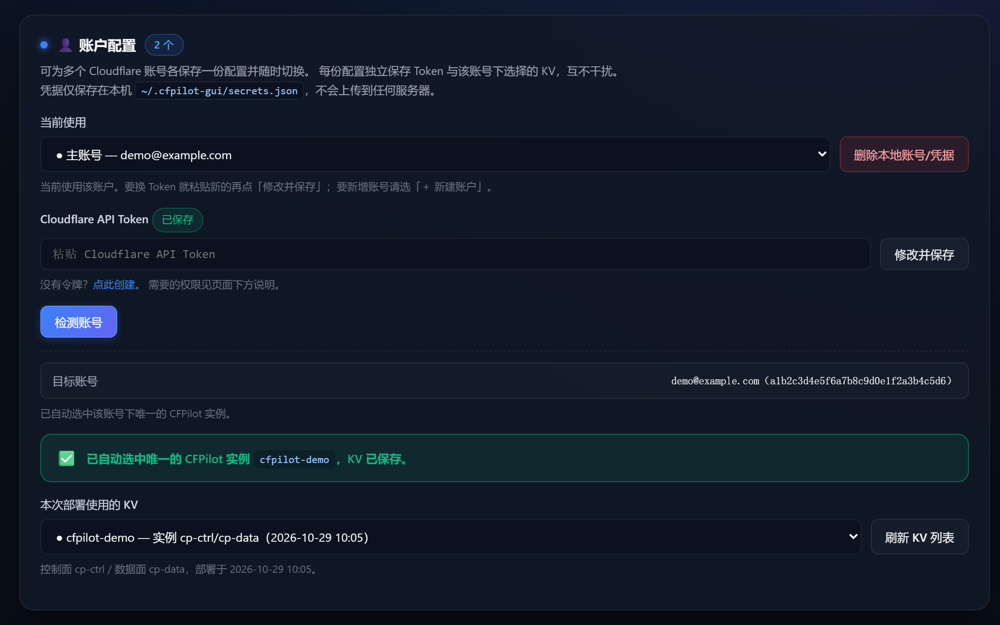
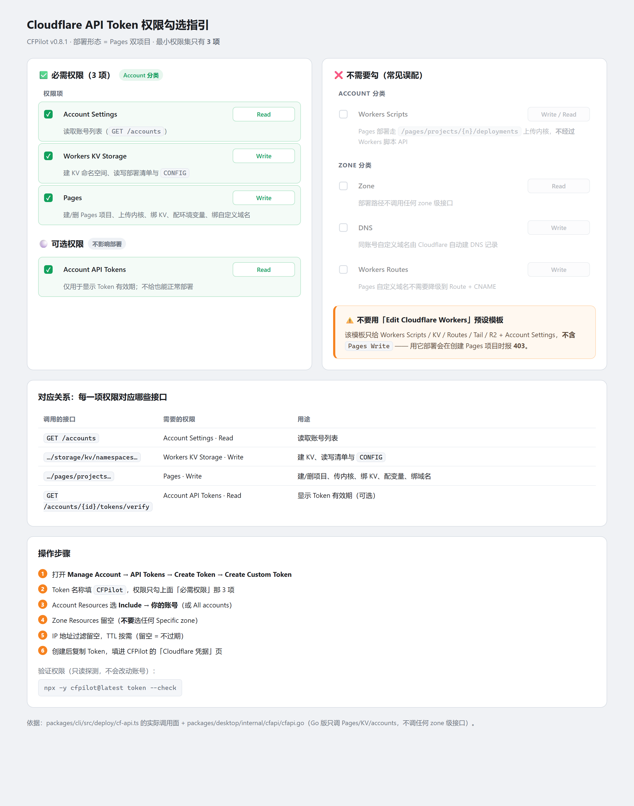

# CFPilot

> Cloudflare 代理微内核 · 真连接优选面板 · 一键部署
> MIT License · 控制面+数据面完全自研（无第三方内核依赖）

· 把「代理内核 + 优选订阅 + 本地真连接优选 + 中文部署向导」整合成一套方案；

· 采用双 pages 项目部署：控制面  (web管理面板) + 数据面（流量转发）；

· 静态脱敏 + 交叉混淆，稳定无1101、8000119，但也支持在触发限制后无损更新部署；

· 解决优选 IP 困扰：**本地真连接优选完全杜绝延迟是** **`-1`**。

***

## 目录

- [部署](#部署)

- [优选 IP](#优选-ip)

- [导入订阅](#导入订阅)

- [使用须知](#使用须知)

- [常见问题](#常见问题)

- [技术实现](#技术实现)

- [配置项与环境变量](#配置项与环境变量)

- [免责声明](#免责声明)

***

## 部署

> ⚠️ **部署前必读**

> 全自动化：填 Token  → 自动部署  → 自动优选换 IP → 自动更新内核 → 日常维护 。
>
> 1. 全自动化使用需获取 Cloudflare Api Token 至少**三个权限** 。
> 2. **必须两个 Pages 项目**（控制面 + 数据面），无风控最佳实践。
> 3. **不要与其它项目共用 KV** 。
> 4. 免 Api Token 部署请**选择手动部署**流程。

<details>
<summary><b>① 远程部署（npx，无需安装）</b></summary>

<br>

```bash
npx -y cfpilot@latest deploy
```

交互式引导会依次完成：检测账号 → 创建/复用 KV → 部署数据面 → 部署控制面 →
绑定变量 → 打印面板地址与密码。

**注意事项**

- 全程约 1-3 分钟，取决于 Cloudflare API 响应

- 部署完成后**立即保存面板密码** —— 云端环境变量是加密的，之后无法再读

- 手动部署没设 `PANEL_PASSWORD` 时，内核会随机生成一个密码并写入 KV 的
  `ADMIN_PW_PLAIN` 供你取回；它只保留到**第一次登录成功**为止（之后自动删除）

- 同一账号部署第二个实例：加 `--new-kv`(不建议同账号多实例)

</details>

<details>
<summary><b>② CLI 安装部署（npm 全局安装）</b></summary>

<br>

```bash
npm i -g cfpilot
cfpilot
```

进入中文交互菜单：

```
┌──────────────────────────────────────────────────┐
│ cfpilot                                          │
├──────────────────────────────────────────────────┤
│ Cloudflare Pages 代理部署与优选                  │
└──────────────────────────────────────────────────┘

  当前状态
  账号  未配置
  实例  未配置
  凭据  未配置

  ❯ 部署新实例
    更新现有实例
    查看实例状态
    本地优选（真连接测速）
    修改面板密码
    检查 Token 权限
    配置（Token / 账号 / KV）
    帮助
    退出
```

也支持子命令（供脚本自动化）：

```bash
cfpilot deploy      # 部署
cfpilot scan        # 本地优选
cfpilot status      # 查看实例
cfpilot token --check  # 检查 Token 权限
cfpilot config      # 配置管理
```

**注意事项**

- 首次进入「配置」菜单填 Token，会自动识别账号与已有实例

- 配置保存在 `~/.cfpilot/config.json`，Token 显示时脱敏

- 该文件权限为 `0600`、目录 `0700`（一旦选择保存 Token，它等同于账号凭据）

- `cfpilot deploy --token <TOKEN>` 会把 Token 留在 Shell 历史里；
  更安全的方式是进入交互菜单填写，或设环境变量 `CF_API_TOKEN`

- 需要 Node.js 18+

</details>

<details>
<summary><b>③ WebUI 部署工具（Go 版图形界面，推荐）</b></summary>

<br>

到 [Releases](https://github.com/xmwengxing/CFPilot/releases) 下载对应平台文件：

| 平台          | 文件                                       |
| ----------- | ---------------------------------------- |
| Windows x64 | `cfpilot-<版本>-windows-amd64.exe`（8.3 MB） |
| Linux x64   | `cfpilot-<版本>-linux-amd64`（先 `chmod +x`） |
| Linux arm64 | `cfpilot-<版本>-linux-arm64`               |

运行后托盘出现图标，系统浏览器自动打开管理界面。



界面分五个页签（**凭据 / 部署 / 优选 / 说明 / 日志**），下方是常驻运行日志。

- **凭据页**：填 Token → 自动检测账号 → 自动列出 KV；账号下只有 **1 个** CFPilot 实例时
  自动选中并保存（如上图），**0 个 / 多个**会用醒目红框提示（选错 KV 会让后续操作作用到别的实例上）

- **部署页**：全新部署时若无 KV 会自动创建

- **优选页**：「自动识别」一次填好域名与 WS 路径 → 开始优选 → 回填面板

- **说明页**：安全说明、Token 权限清单、应用更新

**注意事项**

- 单文件静态可执行，**零依赖**，不需要预装 Node.js

- 启动后**自动打开**管理界面（`--no-browser` 可关）

- 服务只监听 `127.0.0.1`，凭据存在本机 `~/.cfpilot-gui/secrets.json`
  （文件 `0600`、目录 `0700`；Windows 下由用户目录的 ACL 保护）

- 「允许局域网访问」默认关闭。开启后仅额外放行私有网段，
  且仍需一次性启动令牌 → Session Cookie 才能操作，不是只靠 Origin 校验

- 应用内更新会先取官方 Release 的 `cfpilot-desktop-SHA256SUMS`，
  校验安装包摘要后再提示替换；清单缺失或摘要不符一律拒绝（镜像不参与校验）

- 右键托盘可查看服务状态、复制地址、修改端口、启停服务、快捷一键优选 IP

- 常用参数：`--no-browser`（不自动开浏览器）、`--no-tray`（无桌面环境）、
  `--console`（日志写文件）、`--check`（只自检）

### 托盘菜单

| 菜单项        | 作用                         |
| ---------- | -------------------------- |
| 打开业务界面     | 打开管理界面                     |
| 复制服务地址     | 复制当前地址                     |
| 停止服务       | 启停本地服务                     |
| 切换端口       | 预设端口，一键切换                  |
| 允许局域网访问    | 同网段其它设备可访问                 |
| **检查应用更新** | 检查 exe 有无新版（外壳 / 界面 / 优选器） |
| **检查部署更新** | 检查线上内核有无新版（数据面 / 控制面）      |
| 一键优选 IP    | 后台自动完成优选 IP 并回填面板，更新订阅食用   |
| 退出 CFPilot | 停止服务并退出                    |

</details>

<details>
<summary><b>④ 手动部署（Cloudflare 控制台）</b></summary>

<br>备用方案，用仓库根目录的两份压缩包手动上传。

| 文件                                               | 用途         |
| ------------------------------------------------ | ---------- |
| [`CFPilot-dataplane.zip`](CFPilot-dataplane.zip) | 数据面（纯转发）   |
| [`CFPilot-control.zip`](CFPilot-control.zip)     | 控制面（面板与订阅） |

> 两份包随每次构建自动更新，与本仓库代码一致。

**第 1 步：创建 KV**

Cloudflare 控制台 → **存储和数据库 → KV** → 创建命名空间，记下**命名空间 ID**。

**第 2 步：部署数据面**

1. **Workers 和 Pages → 创建 → Pages → 上传资产**

2. 项目名随意（建议普通名称，如 `blog-assets-sync`）

3. 上传 `CFPilot-dataplane.zip`，记下项目域名（形如 `xxx.pages.dev`）

4. **设置 → 变量和密钥**，添加：

   | 名称              | 值                  |
   | --------------- | ------------------ |
   | `UUID`          | 自己的 UUID（36 位标准格式） |
   | `WS_PATH`       | 自定义路径，如 `/abc123`  |
   | `ENABLE_TROJAN` | `true` / `false`   |
   | `ENABLE_XHTTP`  | `true` / `false`   |

5. **设置 → 函数 → KV 命名空间绑定**：变量名 `KV` → 第 1 步的命名空间

6. **重新上传一次压缩包**（绑定与变量只对之后的部署生效）

**第 3 步：部署控制面**

1. 另建一个 Pages 项目，上传 `CFPilot-control.zip`

2. **设置 → 变量和密钥**：

   | 名称               | 值                 |
   | ---------------- | ----------------- |
   | `UUID`           | 与数据面相同            |
   | `WS_PATH`        | 与数据面相同            |
   | `DATA_HOST`      | 第 2 步记下的**数据面域名** |
   | `PANEL_PATH`     | 面板路径，如 `/mypanel` |
   | `ADMIN_PASSWORD` | 面板登录密码            |

3. **设置 → 函数 → KV 命名空间绑定**：`KV` → 同一个命名空间

4. **重新上传一次压缩包**

**第 4 步：访问**

打开 `https://<控制面域名><PANEL_PATH>`，用 `ADMIN_PASSWORD` 登录。
订阅地址：`https://<控制面域名>/sub/<UUID>`

**更新时**：分别打开两个 pages 项目 → 点击新建部署 → 分别上传新版 zip → 部署完成更新。

</details>

***

## 优选 IP

部署完成后，建议跑一次本地真连接优选，把「看起来快但实际不可用」的 IP 剔掉。

```bash
# 已安装 CLI
cfpilot scan

# 或直接用 npx
npx -y cfpilot@latest scan
```

交互式引导会：识别实例 → 自动填域名与 WS 路径 → 扫描 → 询问是否回填面板。

**通用流程**

1. **关掉所有代理工具**（含 TUN 模式与系统代理）
2. 选择实例（或手动填数据面域名 + WS 路径）
3. 设置采样数与是否跳过测速后开始优选（建议默认）
4. 扫描完成后选 `y` 自动回填，或选 `N` 复制结果手动粘贴
5. 回填后面板「节点来源 → 手动优选 IP」即可看到列表

- 桌面版根据图形界面提示说明操作，易用性更强。

***

## 导入订阅

面板首页给出三种订阅地址，**按 User-Agent 自动识别格式**：

| 客户端                             | 拿到的格式       |
| ------------------------------- | ----------- |
| Clash Verge / Clash / mihomo    | YAML        |
| sing-box                        | JSON        |
| v2rayN / Shadowrocket / NekoBox | Base64 分享链接 |

也可显式指定：`?target=clash` / `?target=singbox` / `?target=base64`。

节点的关键约定：`server` = 优选出的 **IP**，`sni` / `Host` = **你的域名**（固定），端口 = `443`。

***

## 使用须知

### API Token 权限

在 [Cloudflare 控制台 → API Tokens](https://dash.cloudflare.com/profile/api-tokens)
创建**自定义 Token**，按下面三项勾选（分类都是 **Account**，权限级别都是 **Read/**Edit）：

| 权限项（控制台显示名）                  | 级别   | 用途                                  |
| ---------------------------- | ---- | ----------------------------------- |
| **Account Settings Read**    | Read | 读取账号列表（`GET /accounts`）             |
| **Workers KV Storage Write** | Edit | 建 KV、读写部署清单与 `CONFIG`               |
| **Pages Write**              | Edit | 建/删 Pages 项目、上传内核、绑 KV、配环境变量、绑自定义域名 |
| **Account API Tokens**       | Read | 可选，仅用于显示 Token 有效期                  |

<details>
<summary><b>📋 点开看「照着勾」的图解</b>（哪些必勾 / 哪些不用勾 / 操作步骤）</summary>



</details>

> ### 一个 KV 只能装一对实例

内核在 KV 里用的键全局平铺（`CONFIG` / `PANEL_PATH` / `SESSION:*` …），无实例前缀。
不同实例共用一个 KV 会互相覆盖 UUID、WS 路径和面板密码 —— 向导写入前会校验归属，
目标 KV 属于别的实例时**直接中止**。

- 首次部署：自动新建 KV；部署一对 pages 实例：控制面 + 数据面

- 更新实例：自动探测到唯一的实例并复用（UUID 与 WS 路径不变，订阅地址不用改）

- 多实例：`--kv <命名空间ID>` 明确指定

### 数据面出站能力边界

| 目标类型                            | 能否打通                                   |
| ------------------------------- | -------------------------------------- |
| 普通站点（baidu / qq / amazon 等）     | ✅ 直连                                   |
| Cloudflare 网段目标                 | ✅ 内置第三方反代入口（面板可自配）                     |
| Google / YouTube / GitHub 等 443 | ✅ 内置假活检测会自动切反代；若不通建议配 SOCKS5/HTTP 代理落地 |

***

## 订阅接入

节点形态在面板「入站配置」里选，默认只下发 **VLESS + WebSocket**（兼容性最好）。

| 形态                        | 支持        |
| ------------------------- | --------- |
| VLESS + WS                | 全部客户端     |
| Trojan + WS               | 全部客户端     |
| VLESS + XHTTP（stream-one） | 仅 Xray 内核 |

> Clash / sing-box 内核不支持 XHTTP，订阅这两种格式时会自动跳过该形态。

### ECH（Encrypted Client Hello）

ECH 把 TLS ClientHello 里的真实 SNI 加密，隐藏你访问的是哪个域名。
**这是客户端侧的能力** —— 内核只负责把参数写进订阅，由支持 ECH 的客户端
（mihomo / Clash Verge、sing-box 1.13+、v2rayN）实际执行；客户端不支持时参数被忽略，不影响连接。

**默认关闭**，在面板「出站与抗封锁」页勾选「启用 ECH 加密」后保存即可。
没有自定义域名时客户端连的是 `*.pages.dev`，ECH 的实际收益有限。

***

## 常见问题

**Q：优选结果全是** **`-1`？**
按顺序查：① 是否绑了自定义域名；② 客户端 `sni` 与 `Host` 是否都指向你的域名；
③ 优选时 `--host` 是否和实际部署一致；④ 端口是否是 443 等 TLS 端口；
⑤ 跑优选时是否关了代理工具。

**Q：配了 SOCKS5 代理但不生效？**
检查这几项：① 代理地址是否可公网访问（`127.0.0.1` / `192.168.x` 这类地址数据面连不到）；
② 代理是否支持 TLS 1.3（HTTPS 代理需要）；③ 代理服务器是否有 **IPv4** 公网地址
（数据面的出站只支持 IPv4）。

**Q：面板打不开 / 404？**
面板路径是部署时随机生成的，向导终端里打印过。忘了可以用
`npx wrangler kv key get --binding KV PANEL_PATH` 查回。

**Q：XHTTP 节点连不上？**
需要 Xray 内核（`type=xhttp`、`mode=stream-one`），Clash / sing-box 请改用 WS 节点。
另外，XHTTP 在部分网络环境里会被拦截：Cloudflare 对
`Content-Type: application/grpc` 的请求可能直接返回 403，
此时**任何** XHTTP 客户端都无法使用。建议把 XHTTP 当作实验性形态，
主用 WS（WS 在任何环境都可工作）。

**Q：免费额度 CPU 超限？**
内核内置 Free CPU 预算保护，可在面板调低 `DLS` / `MAX_LATENCY` 阈值，或减少远程 CSV 行数。

**Q：想看「为什么这个目标连不上」？**
自研数据面提供完整诊断端点，需要带上**完整 UUID**（面板「节点配置」里可见）：

```bash
curl \
  -H "x-cfpilot-token: <完整 UUID>" \
  https://<数据面域名>/__diag
```

返回最近 20 条完整出站诊断（失败类型 / 原始错误 / 候选 / 修复建议）——
WebSocket close frame 装不下这些（且超长会被边缘静默丢弃），所以单独开了个口子。

> ⚠️ 只认**完整 UUID**：早期允许 UUID 前 8 位，但那是 32 bit 搜空间，
> 可被在线枚举（诊断里有你访问过的目标域名）。失败尝试也有限速（每 isolate 每分钟 10 次）。

**Q：`/__edge_probe`** **会不会被别人刷流量？**
该端点必须保持免鉴权（它是优选的核心：WS 101 校验 + 流式测速），所以内置两道闸：
单次最多 8 MiB，以及**每个 isolate 每 10 分钟约 6 GiB** 的总预算，超出返回 429。
正常一轮优选（约 50 条候选 × 8 连接 × 5 MiB）大约 2 GiB，跑不满。
如果你担心被滥用，可在 Cloudflare 控制台给该路径加一条 Rate Limiting 规则。

***

## 技术实现

### 优选器：三阶真连接校验

传统工具借第三方 CDN 测速，扫出来的 IP 填进节点几乎全 `-1`。CFPilot 的做法是
**每一步都带着你自己的域名**：

| 阶段 | 手段                                           | 拦掉什么                                         |
| -- | -------------------------------------------- | -------------------------------------------- |
| 一  | 并发 TCP 初筛 + **TLS 握手耗时排序**（候选按网段可用率加权采样）     | 连不上的 IP、握手慢的 IP                              |
| 二  | **WS 101 握手 + PING/PONG 响应体校验**              | Enterprise 专属 IP、SNI 阻断、「101 通但数据面不响应」的假活 IP |
| 三  | 仅对通过前两阶的 IP 请求 `/__edge_probe?bytes=N` 测真实下行 | —                                            |

单一自研实现，无第三方内核依赖。

| 能力       | 支持情况                               |
| -------- | ---------------------------------- |
| 入站协议     | VLESS-WS / Trojan-WS / VLESS-XHTTP |
| 出站代理池    | SOCKS5 / HTTP / HTTPS 全支持          |
| DoH 优选解析 | 可开关                                |
| 反代入口     | 用户可自配 + 内置表                        |
| 故障诊断     | 失败分级 + `GET /__diag` 查看完整原因        |

### 仓库结构

```text
CFPilot/
├── CFPilot-control.zip    # 控制面 pages 包
├── CFPilot-dataplane.zip  # 数据面 pages 包
└── packages/
    ├── worker-core/       # 边缘内核 + 中文面板（Pages 产物）
    ├── cli/               # cfpilot —— 部署 + 优选（npm 包，含交互菜单）
    ├── ui/                # 界面源码（单一来源，Go 版复用）
    └── desktop/           # Go 桌面版（单二进制 + 托盘）
```

> 界面源码独立在 `packages/ui`：Go 版构建时把它的产物 `go:embed` 进 exe，
> 保证「一份界面、一处维护」。Electron 外壳已移出仓库（本地保留用于实验）。

***

## 配置项与环境变量

优先级：**KV(`CONFIG`) > 环境变量 > 内置默认值**。

### 常用环境变量

| 变量                                             | 说明                                                       |
| ---------------------------------------------- | -------------------------------------------------------- |
| `UUID`                                         | VLESS UUID                                               |
| `WS_PATH`                                      | WebSocket 路径（**值要带前导斜杠**；`PATH` 是 Pages 保留名，别用）          |
| `TROJAN_PASSWORD`                              | Trojan 密码                                                |
| `ENABLE_TROJAN` / `ENABLE_XHTTP`               | 入站开关                                                     |
| `DATA_HOST`                                    | 数据面域名（拆分部署时控制面用它生成订阅）                                    |
| `PANEL_PATH` / `PANEL_PASSWORD`                | 面板路径与初始密码                                                |
| `PROXYIP`                                      | ProxyIP 池（按直连落地语义解析）                                     |
| `SOCKS5` / `HTTP_PROXY`                        | 落地代理（仅自研数据面）。`https://` 前缀表示代理本身走 TLS，可用 `#sni=域名` 指定握手名 |
| `NAT64`                                        | NAT64 前缀，如 `64:ff9b::`                                   |
| `RELAY_POOL` / `USE_BUILTIN_RELAY`             | 自定义反代入口池 / 内置表开关                                         |
| `RESOLVE_PREFERRED`                            | 出站前自动 DoH 解析优选 IP（默认开）                                   |
| `SUB_VARIANTS`                                 | 下发的节点形态，逗号分隔，默认 `vless-ws`                               |
| `OFFICIAL_IP_COUNT` / `PREFERRED_DOMAIN_COUNT` | 内置来源数量（默认 20 / 10）                                       |
| `DLS` / `MAX_LATENCY`                          | 订阅池的最低速度 / 最高延迟阈值                                        |

### 常用 KV 键

| 键                     | 内容                                          |
| --------------------- | ------------------------------------------- |
| `CONFIG`              | 用户配置 JSON（含 uuid / wsPath / trojanPassword） |
| `CFP_DEPLOY_MANIFEST` | 部署清单，**判断 KV 归属的唯一依据**                      |
| `LOCAL_PREFERRED_IPS` | 本地优选结果                                      |
| `SCANNER_TOKEN`       | 扫描回填令牌                                      |

### scanner 常用参数

| 参数                     | 默认       | 说明                                                          |
| ---------------------- | -------- | ----------------------------------------------------------- |
| `--host`               | 必填       | 你的域名（作为 SNI / Host）                                         |
| `--path`               | `/vless` | 目标项目的 WS 路径                                                 |
| `--sample`             | `6556`   | 候选采样数                                                       |
| `--top`                | `15`     | 返回条数                                                        |
| `--countries`          | —        | 机房国家筛选，如 `HK,JP,SG`；也接受分组 `ASIA` / `US` 与机房码 `HKG`（自动归一到国家） |
| `--token`              | —        | 回填令牌（不填则只输出不回填）                                             |
| `--no-verify`          | —        | 只做 101 握手，跳过响应体校验（对接非 CFPilot 项目时用）                         |
| `--speed-mode`         | `auto`   | `probe`（走目标探针端点，最忠实）/ `url`（公开测速地址，任何项目可用）/ `auto`          |
| `--cidr` / `--ip-file` | —        | 自定义网段 / 本地 IP 列表                                            |

完整参数见 `npx -y cfpilot@latest scan --help`。

***

## 免责声明

**本项目仅作学习交流使用**，用于查找资料、学习网络知识，**不鼓励、不支持任何违法行为**。

- 项目中涉及的所有方法与技术均来自互联网公开资料，仅供交流学习；

- 使用者需自行遵守所在地法律法规与 Cloudflare 服务条款（尤其是 Free 套餐的流量与 CPU 限制），并对自身使用行为负全部责任；

- 任何人因使用本项目产生的任何后果（包括但不限于账号封禁、服务中断、法律责任），**本项目及作者概不负责**；

- 如有侵权或不当之处，请联系仓库 issue / PR，将第一时间处理。

***

## License

[MIT](LICENSE)
